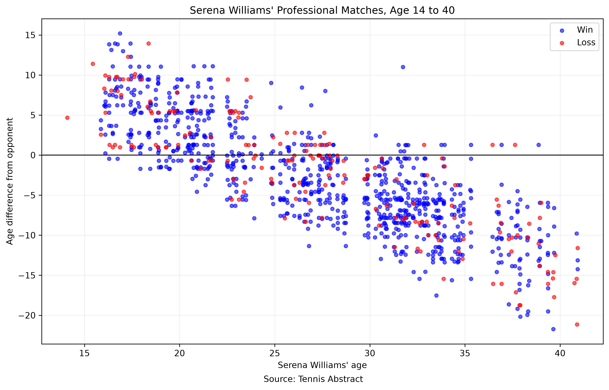

# Serena Williams Career Matches: Age Comparison

## Introduction

This project reproduces a visualization of Serena Williams' professional tennis matches, based on a graphic published by The New York Times. The goal is to examine the age differences between Serena Williams and her opponents throughout her career.

## Data and Methods

The match data was obtained from Tennis Abstract using the Serena Williams career match records.

The raw JavaScript data was downloaded and processed using Python. The cleaned dataset contains 1,038 matches, including match dates, opponents, results, and player ages.

Serena Williams' age and her opponents' ages were calculated using their dates of birth and the match dates. The age difference was calculated as:

**Age Difference = Opponent Age - Serena Williams' Age**

The scatter plot was created using Python, pandas, and matplotlib.

## Visualization

The x-axis represents Serena Williams' age at the time of each match, while the y-axis shows the age difference between Serena and her opponent. Blue points indicate wins, and red points indicate losses.

## Discussion

The visualization shows a clear trend in the age difference between Serena Williams and her opponents over time. Earlier in her career, Serena frequently competed against older players. As she became older, a greater proportion of her opponents were younger than her.

The plot also illustrates Serena Williams' long professional career, with match records spanning from approximately age 14 to age 40.

## Data Source

Tennis Abstract: https://www.tennisabstract.com/

Raw data: https://www.tennisabstract.com/jsmatches/SerenaWilliamsCareer.js